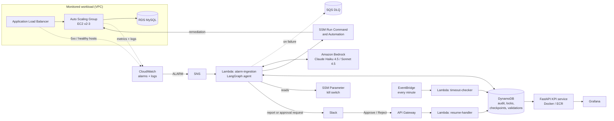
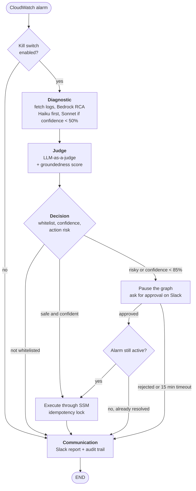

# Self-Healing AIOps Agent on AWS

**An autonomous DevOps agent that diagnoses AWS incidents with an LLM, fixes the safe ones by itself, and asks a human on Slack before doing anything risky.**

[](https://github.com/eyaothmani/DevOps-agent/actions/workflows/ci.yml)


When a CloudWatch alarm fires, the agent collects the logs around the incident and asks **Claude on Amazon Bedrock** for a root-cause analysis. A second model reviews that diagnosis. The agent then runs a whitelisted fix through **AWS Systems Manager**, or, if the fix is risky or the agent isn't confident enough, sends an approval request to **Slack**. Every step is recorded so the agent's decisions can be audited and measured afterwards (MTTR, cost per incident, how often the reviewer agrees, and so on).

---

## Table of contents

- [Why](#why)
- [Architecture](#architecture)
- [How the agent decides](#how-the-agent-decides)
- [Safety by design](#safety-by-design)
- [FinOps](#finops)
- [Observability and evaluation](#observability-and-evaluation)
- [Tech stack](#tech-stack)
- [Repository structure](#repository-structure)
- [Getting started](#getting-started)
- [Testing and quality](#testing-and-quality)
- [CI/CD](#cicd)
- [Chaos engineering](#chaos-engineering)
- [Roadmap](#roadmap)
- [Author](#author)

---

## Why

Most of an on-call engineer's time goes into the same loop: an alarm fires, you open the logs, work out what happened, apply a well-known fix, and write it up. This project automates that loop **without giving up control**:

- **Diagnosis**: an LLM reads the real logs and the alarm context and returns a structured RCA with a confidence score.
- **Action**: only pre-approved remediations can run, and only after several guardrails pass.
- **Human in the loop**: risky actions and low-confidence diagnoses wait for a person to click *Approve* or *Reject* in Slack.
- **Accountability**: every node writes what it contributed to an audit table, and those records drive the KPIs.

## Architecture



| Component | Role |
|---|---|
| **alarm-ingestion** Lambda | Triggered by SNS. Parses the CloudWatch alarm and runs the LangGraph agent. Failed events go to an SQS dead-letter queue. |
| **resume-handler** Lambda | Receives Slack button clicks through API Gateway, verifies the Slack signature, and resumes the paused graph from its DynamoDB checkpoint. |
| **timeout-checker** Lambda | Runs every minute (EventBridge) and cancels any approval request left unanswered for 15 minutes. |
| **DynamoDB** | Four tables: the decision audit trail, idempotency locks, LangGraph checkpoints, and pending validations. |
| **KPI API + Grafana** | FastAPI service, packaged as a hardened Docker image, that serves the evaluation metrics to a Grafana dashboard. |
| **Demo workload** | ALB, an Auto Scaling Group of Apache servers and RDS MySQL, monitored by three alarms: CPU high, 5xx rate and healthy host count. |

## How the agent decides

The agent is a **LangGraph `StateGraph`** with a persistent **DynamoDB checkpointer**. The graph can pause (`interrupt()`) in one Lambda invocation while it waits for a human, and resume in another.



| Alarm type | Allowed remediation | SSM document |
|---|---|---|
| `CPUHigh` | `ScaleOut` | `Custom-ScaleOutASG` (Automation) |
| `ServiceDown` / `HealthyHostCount` | `RestartService` | `AWS-RunShellScript` |
| `HighErrorRate` | `RollbackDeployment` | `Custom-RollbackDeployment` |

## Safety by design

An agent that is allowed to act on production has to be predictable before it is clever. Each guardrail below is implemented and covered by tests:

| Guardrail | Implementation |
|---|---|
| **Kill switch** | SSM parameter `/agent-devops/kill_switch`, read for every incident. It is *fail-closed*: if the parameter can't be read, the agent stays disabled. |
| **Action whitelist** | Each alarm type maps to a closed set of actions. Anything else the LLM suggests is refused. |
| **Confidence threshold** | Below 85% confidence, a human has to approve the action. |
| **Risky actions** | `RestartService` and `RollbackDeployment` always need human approval. |
| **LLM-as-a-judge** | A separate Bedrock call checks the diagnosis against the evidence. If the judge finds it incoherent, the confidence is pushed below the threshold. |
| **Groundedness score** | The share of reasoning steps that are backed by the logs or the alarm context. |
| **Anti-flapping** | A conditional write in DynamoDB holds a lock per resource and action (120 s TTL), so the same fix can't run twice in a row. |
| **Freshness re-check** | After approval, the agent reads the alarm again and skips the fix if the alarm has already recovered. |
| **Validation timeout** | Approval requests that stay unanswered are cancelled automatically after 15 minutes. |
| **Signed Slack callbacks** | Slack requests are checked with HMAC-SHA256 (Slack signature v0) and rejected if they are more than 5 minutes old. |
| **Least privilege** | CI/CD reaches AWS through **GitHub OIDC**, so no long-lived AWS keys are stored. Each Lambda has its own IAM role, and SSM execution is limited to the whitelisted documents. |

## FinOps

- **Model routing**: the agent calls Claude **Haiku** by default and only retries with **Sonnet** when Haiku's confidence is below 50%. The model, token count and cost are logged for every incident.
- **Short-lived environment**: a scheduled workflow runs `terraform destroy` every day, and the infrastructure is recreated from code when needed.
- **Cost guardrails**: an optional AWS Budgets alert, cost-allocation tags (`Environment`, `Owner`), and a 90-day TTL on the audit table.

## Observability and evaluation

The `evaluation/` package turns the audit trail into KPIs. The FastAPI service exposes them and Grafana displays them:

| Endpoint | What it returns |
|---|---|
| `GET /metrics/kpis` | Headline KPIs: incidents, average MTTR, execution success rate, human escalation rate, judge agreement, guardrails triggered, cost per incident |
| `GET /metrics/mttr_par_type` · `/mttr_infra_reel` | MTTR per alarm type, from both the agent's view and the CloudWatch alarm history |
| `GET /metrics/groundedness_par_type` | Groundedness per alarm type |
| `GET /metrics/cout_par_incident` · `/tokens_par_model` | Cost per incident and Haiku vs Sonnet token usage |
| `GET /metrics/status_repartition` · `/cas_echec` · `/securite` | Decision outcomes, documented failure cases, security events |
| `GET /health` | Health check used by Docker and the load balancer |

Other metrics computed: **judge agreement rate**, **confidence calibration**, **execution success rate** and **human escalation rate**. A **golden dataset** (`evaluation/golden_dataset.json`) and a table-management CLI (`python -m evaluation.manage_table`) let you replay, inspect and clean up the audit data.

## Tech stack

| Area | Tools |
|---|---|
| **AI / agents** | LangGraph (StateGraph, `interrupt`, DynamoDB checkpointer), Amazon Bedrock (Claude Haiku 4.5, Claude Sonnet 4.5), structured prompts, LLM-as-a-judge |
| **Backend** | Python 3.11, Pydantic v2, boto3, FastAPI |
| **AWS** | Lambda, SNS, SQS, CloudWatch, Systems Manager, DynamoDB, API Gateway, EventBridge, EC2 / ASG / ALB, RDS, Secrets Manager, ECR, S3, Budgets |
| **Infrastructure as code** | Terraform (S3 remote state + DynamoDB locking) |
| **CI/CD** | GitHub Actions with OIDC, Docker (multi-stage, non-root) |
| **Quality and security** | pytest, Ruff, Bandit, pip-audit, Trivy, tfsec, Checkov, SonarCloud |
| **Monitoring** | CloudWatch, Grafana |

## Repository structure

```text
.
├── agent/                    # The agent (deployed as Lambda functions)
│   ├── graph/                #   LangGraph: graph, nodes, whitelist, freshness check
│   │   └── nodes/            #   kill_switch · diagnostic · judge · decision · communication
│   ├── lambda_handler.py     #   Entry point: SNS alarm → graph
│   ├── resume_handler.py     #   Slack interactivity: approve / reject → resume graph
│   ├── timeout_checker.py    #   Cancels expired approval requests
│   ├── bedrock_client.py     #   Bedrock calls (RCA + judge), retries, token accounting
│   ├── rca_prompt.py         #   Diagnostic and judge prompts
│   ├── ssm_executor.py       #   Remediation through SSM, with timeouts and outcome mapping
│   └── idempotency_lock.py   #   DynamoDB anti-flapping lock
├── evaluation/               # Metrics engine, MTTR, KPI API (FastAPI), table-management CLI
├── chaos/                    # Chaos campaigns: cpu_high, service_down, high_error_rate
├── infra/                    # Terraform: VPC, ALB/ASG, RDS, Lambda, DynamoDB, SNS, alarms...
│   └── bootstrap/            #   One-off: S3 state bucket, lock table, ECR, GitHub OIDC role
├── tests/                    # Unit and integration tests
├── .github/workflows/        # CI, CD, E2E chaos test, scheduled destroy
├── build_lambda_package.py   # Builds the Lambda deployment package
├── Dockerfile                # KPI API image
└── docker-compose.yml        # Local Grafana
```

## Getting started

### Prerequisites

- An AWS account with **Amazon Bedrock** access to Claude Haiku 4.5 and Claude Sonnet 4.5 (`eu.` inference profiles, region `eu-north-1` by default)
- Terraform ≥ 1.9, Python 3.11, Docker (optional)
- A Slack app with an **Incoming Webhook** and **Interactivity** turned on

### 1. Run the tests locally (no AWS needed)

```bash
git clone https://github.com/eyaothmani/DevOps-agent.git && cd DevOps-agent
python -m venv .venv && source .venv/bin/activate   # Windows: .venv\Scripts\activate
pip install -r requirements.txt -r requirements-dev.txt
pytest tests/unit tests/integration
```

### 2. Bootstrap (once)

Creates the Terraform state bucket, the lock table, the ECR repository and the GitHub OIDC role:

```bash
cd infra/bootstrap
terraform init
terraform apply -var="github_repo=<owner>/<repo>"
```

### 3. Deploy

```bash
python build_lambda_package.py         # builds the Lambda package
cd infra
export TF_VAR_SLACK_WEBHOOK_URL="https://hooks.slack.com/services/..."
export TF_VAR_SLACK_SIGNING_SECRET="..."
export TF_VAR_budget_alert_email="you@example.com"
terraform init && terraform apply
```

Then set the Slack app's **Interactivity Request URL** to `https://<api-id>.execute-api.<region>.amazonaws.com/slack/interactivity`.

The agent starts **enabled**. To stop it immediately (emergency stop), flip the kill switch:

```bash
aws ssm put-parameter --name /agent-devops/kill_switch --value DISABLED --type String --overwrite
```

### 4. KPI dashboard (optional)

```bash
docker build -t agent-kpi-api . && docker run -p 8000:8000 agent-kpi-api
docker compose up -d                   # Grafana on http://localhost:3001
```

All settings are documented in [`.env.example`](.env.example).

## Testing and quality

- **468 tests** (443 unit, 25 integration), about **85% line coverage**
- Integration tests run the **whole graph end to end** with AWS mocked: human-in-the-loop flow, execution guardrails, judge and governance
- Static analysis: **Ruff** (lint), **Bandit** (SAST), **pip-audit** (dependency CVEs), **SonarCloud** (quality gate)
- Infrastructure scanning: **tfsec** and **Checkov**. Image scanning: **Trivy**, which blocks the deployment on findings.

```bash
pytest tests/unit --cov=agent --cov=evaluation
ruff check agent/ evaluation/ tests/
```

## CI/CD

| Workflow | Trigger | What it does |
|---|---|---|
| `ci.yml` | push / PR | Lint → unit tests + coverage → integration tests → Bandit, pip-audit, tfsec, Checkov → SonarCloud (runs only when `SONAR_TOKEN` is set) |
| `cd.yml` | after a green CI on `main`, daily, manual | Docker build → **Trivy gate** → push to ECR → Terraform plan and apply (the apply step is currently disabled because the demo environment has been torn down) |
| `e2e.yml` | manual | Real end-to-end test on AWS: deploys the stack, injects a CPU spike with the chaos suite and checks the agent's outcome |
| `scheduled-destroy.yml` | daily, manual | Tears the environment down to save costs |
| `import.yml` · `unlock.yml` | manual | Terraform maintenance: import a resource, release a state lock |

AWS access in every workflow goes through **OIDC**, with no static credentials.

> **Turning on deployments in a fork:** CI needs no secrets. CD and the scheduled destroy only run automatically when the repository variable `ENABLE_AWS_DEPLOY` is `true`. They also need the secrets `AWS_ROLE_ARN`, `TF_VAR_SLACK_WEBHOOK_URL`, `TF_VAR_SLACK_SIGNING_SECRET` and `TF_VAR_BUDGET_ALERT_EMAIL`. The role comes from `infra/bootstrap` (`-var="github_repo=<owner>/<repo>"`).

## Chaos engineering

The `chaos/` package injects real failures into the environment and measures how the agent responds:

```bash
python -m chaos.run_campaign --scenario cpu_high       --runs 12 --duration 300
python -m chaos.run_campaign --scenario service_down   --runs 12 --outage-duration 120
python -m chaos.run_campaign --scenario high_error_rate --runs 12 --rate 0.3
```

Each run is logged to CSV for MTTR and success-rate analysis.

## Roadmap

- [ ] More alarm types and remediations, such as RDS storage and memory pressure
- [ ] Retrieval over past incidents (RAG on the audit trail) to improve the RCA
- [ ] Multi-account support through cross-account roles
- [ ] Replace the incoming webhook with a full Slack app (threads, `/agent` commands)

## Author

**Eya Othmani**, engineering student (AI / GenAI, MLOps / LLMOps)
[LinkedIn](https://www.linkedin.com/in/eya-othmani) · [GitHub](https://github.com/eyaothmani)

The project was organised as an agile backlog: epics and user stories are referenced as `US x.y` in the code and commit history.

## License

Released under the [MIT License](LICENSE).
